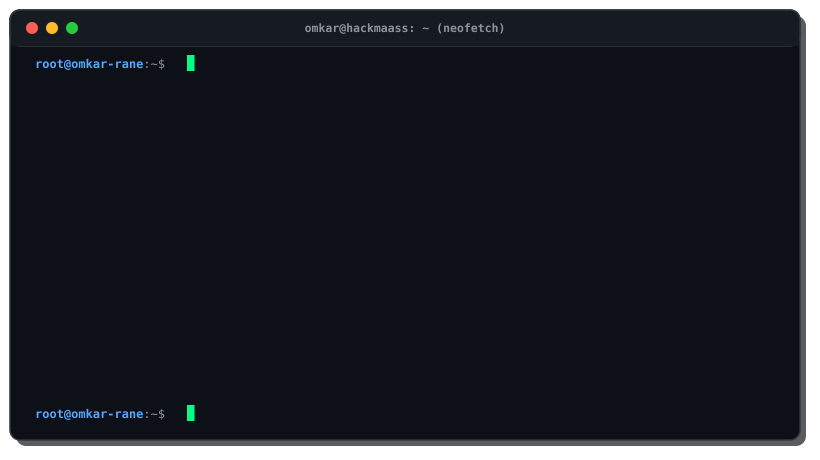

  

   

  <!-- Typing SVG: Terminal Protocol -->
  

   

      

### `>_ System.Identity`

  

### `>_ Classified Ops // Flagship Repos`

| Operation | Debrief |
| :--- | :--- |
| 🛡️ [**`Diskman`**](https://github.com/Hackmaass/Diskman) `PowerShell` · Sec & Systems | High-speed automated system cleaner & disk space reclaim utility. |
| 🛡️ [**`CT-Flow`**](https://github.com/Hackmaass/CT-Flow) `Python` · Sec & Systems | Autonomous Cybersecurity Copilot for rapid threat triage & incident response. |
| 🤖 [**`Ada`**](https://github.com/Hackmaass/Ada) · [live](https://ada-gules.vercel.app) `TypeScript` · Agentic AI | Adaptive Decision Agent framework for multi-step reasoning & autonomous execution. |
| 🤖 [**`Vector`**](https://github.com/Hackmaass/Vector) `Python` · Agentic AI | RAG-based intelligent interview and automated technical evaluation platform. |
| 👁️ [**`Signify_`**](https://github.com/Hackmaass/Signify_) `TypeScript` `OpenCV` · Vision & HCI | Real-time computer vision sign language translator & interactive tutoring engine. |
| 🌐 [**`Spectrav2`**](https://github.com/Hackmaass/Spectrav2) `JavaScript` · Web3 & DEX | High-fidelity platform with decentralized exchange, agentic wallet & NFT minting. |
| 💼 [**`Karma`**](https://github.com/Hackmaass/Karma) · [live](https://karma-pi-seven.vercel.app) `Next.js` · Enterprise | Modern enterprise workforce management & automated HR operations ecosystem. |
| ☁️ [**`Lost-in-cloud`**](https://github.com/Hackmaass/Lost-in-cloud) `JavaScript` · Cloud Ops | Distributed cloud experimentation & multi-tier deployment architecture. |

### `>_ The Arsenal // Tech Matrix`

  

### `>_ Live Telemetry`

  

   

  
  

    

  <picture>
    <source media="(prefers-color-scheme: dark)" srcset="https://raw.githubusercontent.com/Hackmaass/Hackmaass/output/github-snake-dark.svg" />
    <source media="(prefers-color-scheme: light)" srcset="https://raw.githubusercontent.com/Hackmaass/Hackmaass/output/github-snake.svg" />
    
  </picture>

  <code>&gt;_ connection.secure() // transmission.end</code>

