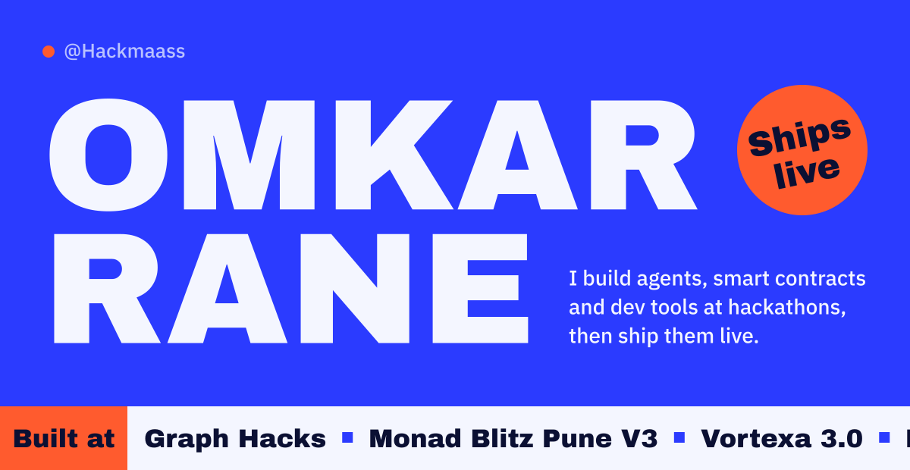
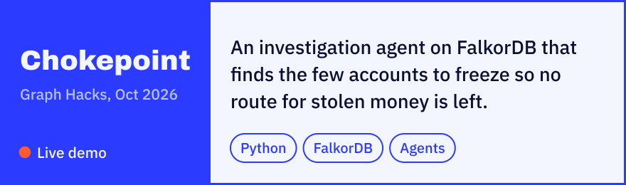
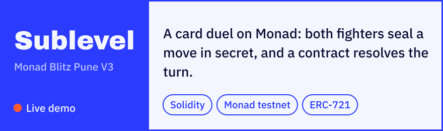
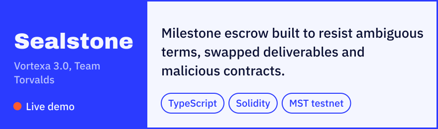
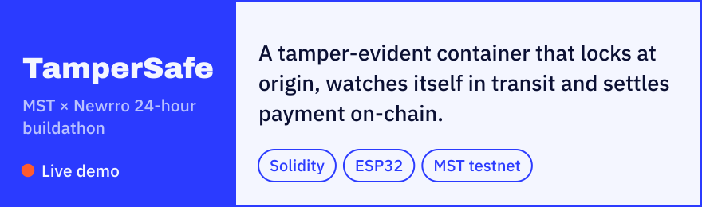
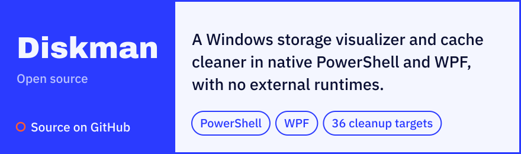
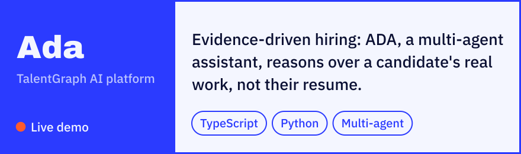
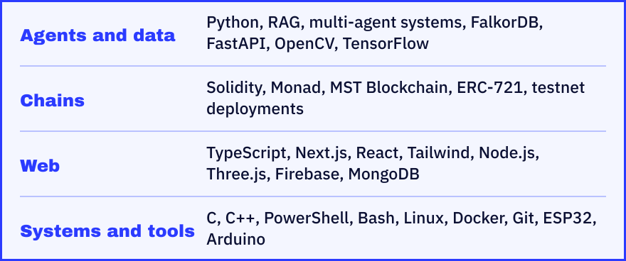
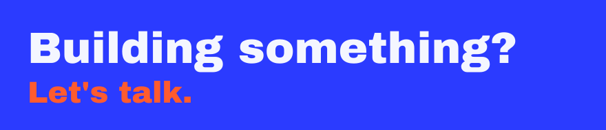

## Selected work

[Live demo](https://chokepoint-uou2.onrender.com/) · [Source](https://github.com/Hackmaass/Chokepoint)

[Live demo](https://sublevel-theta.vercel.app) · [Source](https://github.com/Hackmaass/Sublevel)

[Live demo](https://sealstone-rose.vercel.app/) · [Source](https://github.com/Hackmaass/SealStone)

[Live demo](https://tampersafe.vercel.app/) · [Source](https://github.com/Hackmaass/TamperSafe)

[Source](https://github.com/Hackmaass/Diskman)

[Live demo](https://ada-gules.vercel.app) · [Source](https://github.com/Hackmaass/Ada)

Also shipped: [Signify_](https://github.com/Hackmaass/Signify_), a sign language tutor · [CT-Flow](https://github.com/Hackmaass/CT-Flow), a cybersecurity copilot · [Veyra](https://github.com/Hackmaass/Veyra), an intelligent companion · [Kevin](https://github.com/Hackmaass/Kevin), a desktop companion in C++

## Toolbelt

## Activity

<picture>
  <source media="(prefers-color-scheme: dark)" srcset="https://raw.githubusercontent.com/Hackmaass/Hackmaass/output/github-snake-dark.svg" />
  <source media="(prefers-color-scheme: light)" srcset="https://raw.githubusercontent.com/Hackmaass/Hackmaass/output/github-snake.svg" />
  
</picture>

[omkarrane0934@gmail.com](mailto:omkarrane0934@gmail.com) · [LinkedIn](https://linkedin.com/in/omkardrane) · [X](https://x.com/OmkarRa72850136) · [Instagram](https://instagram.com/omkararara)
